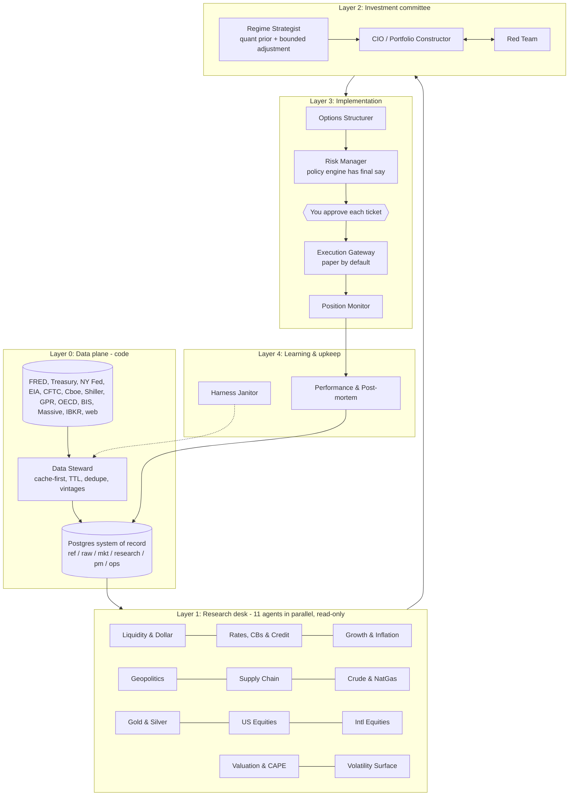

# Macro Trader v2: Design for Approval

**Status:** Draft v0.1, awaiting your approval. Nothing here trades yet.
**Companion files:** [HARNESS.md](HARNESS.md) (how the harness works) · [OPEN_QUESTIONS.md](OPEN_QUESTIONS.md) (decisions I need from you) · [blueprint.html](blueprint.html) (visual dashboard of this plan) · [`config/`](../../config) · [`db/schema/001_core.sql`](../../db/schema/001_core.sql) · [`contracts/`](../../contracts)

> This is a research and decision-support system, not investment advice. Selling options carries large tail risk; the design caps it but cannot remove it.

---

## 1. Objective

Run a **$1,000,000 macro book** that beats the **effective Fed funds rate** (the hurdle) by expressing macro views through **out-of-the-money short options** instead of outright longs or shorts.

| Metric | Target (to be proven in paper trading) |
|---|---|
| Excess return over Fed funds, net of costs | +4% to +8% per year |
| Max drawdown from peak | ≤ 12% (hard circuit breakers at 5 / 8 / 12%) |
| Buying-power used | 25–40% of NAV, never above 50% |
| Worst policy stress scenario (equities −20%, IV +25 pts) | ≤ 12% of NAV loss |
| Trades without human approval | Zero |

## 2. How the money is made

The design stacks three return sources. Only the last two need the agents.

```
 Total return  =  T-bill yield on collateral      (≈ Fed funds: the hurdle itself)
               +  volatility risk premium         (implied vol is usually above realized vol)
               +  macro tilt                       (sell puts where we are bullish, call spreads where bearish,
                                                    stand aside where we have no edge)
               −  losses, slippage, fees, model/data costs
```

1. **Collateral earns the hurdle.** At least 85% of NAV sits in short T-bills (or SGOV/BIL). Short options are margined against those T-bills, so the cash keeps earning roughly Fed funds while it backs the options.
2. **The volatility risk premium is the engine.** Index and commodity options are, on average, priced above the volatility that follows. Selling ~16-delta options at 30–60 days to expiry harvests that gap.
3. **Macro decides where and which side.** The research desk decides *which* underlyings to sell premium on, *which side* (puts if bullish, call spreads if bearish, both if range-bound), *how far OTM*, *how much*, and when to stand aside.

**Illustrative base case** (assumptions, not a forecast): average buying power used 35% of NAV; net premium kept after management and losses of 15% per year on that buying power, which is 5.25% of NAV; costs about 0.5% of NAV. That puts excess return over Fed funds at about +4.75%. A good year (20% on 40%) is about +8%. A crash year is bounded by the stress limits at roughly −12%. Paper trading has to prove these numbers before any live capital is used.

## 3. What changes from v1

| Area | v1 (current repo) | v2 (this design) |
|---|---|---|
| Macro inputs | Manual questionnaire; an LLM "auto-fills" current data from memory | Real data from ~15 sources, stored with provenance; LLMs interpret, never supply numbers |
| Market data | Hard-coded estimates (`fetch-market-data` returns fixed spot/IV) | Live chains (Massive / IBKR) with IV and Greeks; point-in-time storage |
| Signal logic | Additive rule scores per asset class | Regime probabilities (4 quadrants) × playbook, plus valuation, liquidity, stress and vol-richness modifiers |
| Option structures | Naked short puts, naked short calls and naked strangles on ES/NQ/CL futures, up to $500k notional per asset | Short puts / put spreads when bullish, **call credit spreads only** when bearish, condors when neutral; ETF/index sizing that fits a $1M book |
| Risk | Per-trade buying-power heuristics | Policy engine: portfolio Greeks, buying power, concentration, 9 stress scenarios, circuit breakers, event blackouts |
| AI | One OpenAI/Claude call per questionnaire section | 19 Claude agents (7 hybrid with code doing the math) in a harness with typed contracts, citation checks, red team, evals |
| Data reuse | None (refetch or re-ask each time) | Cache-first data layer: nothing downloaded twice |
| Execution | None | Paper trading through a gateway; live only with per-ticket approval |

**Kept from v1:** the React + Vite + Tailwind front end (rebuilt into the new dashboard), Supabase Postgres, and the Black–Scholes code (ported to the Python quant library; the TypeScript copy stays for UI display).

## 4. Architecture

Five layers. Data flows up; control and limits flow down. LLMs live only in the research, committee and learning layers. Everything that moves money or computes a number that matters is deterministic code.



## 5. The agents

Full machine-readable definitions are in [`config/agents.yaml`](../../config/agents.yaml). "Hybrid" means code produces the numbers and candidates and Claude makes the judgment call.

| # | Agent | Kind | What it answers |
|---|---|---|---|
| 0 | Data Steward | code | Fetches only what is due, only the delta; archives raw payloads; writes point-in-time observations |
| 1 | Global Liquidity & Dollar | LLM | Is liquidity expanding or draining? US net liquidity (Fed assets − TGA − RRP), ECB/BoJ/PBoC balance sheets, broad USD, funding stress |
| 2 | Rates, Central Banks & Credit | LLM | Policy path vs market pricing, curve shape, real yields, breakevens, term premium, IG/HY spreads; owns the hurdle rate |
| 3 | Growth & Inflation Nowcast | LLM | The two regime axes: growth and inflation scores (level + momentum) for US, EZ, China, Japan, EM |
| 4 | Geopolitics & Policy Risk | LLM | Risk register: conflicts, sanctions, tariffs, elections, chokepoints, each with probability, severity, channel and affected sleeves |
| 5 | Global Supply Chain & Trade | LLM | GSCPI, container freight, inventories, tariffs, semis/critical minerals → inflation pressure |
| 6 | Crude Oil & Natural Gas | LLM | Inventories vs 5-yr range, curve structure, OPEC+, COT positioning, OVX, storage/weather |
| 7 | Gold & Silver | LLM | Real yields, USD, central-bank buying, ETF flows, COT, gold/silver ratio, industrial silver demand |
| 8 | US Equities | LLM | Trend, breadth, earnings revisions, equity risk premium vs real yields, concentration |
| 9 | International Equities | LLM | Europe, Japan, China, India, Brazil, EM: relative strength, local policy, currency effects |
| 10 | Valuation & CAPE | hybrid | US and global CAPE; percentile and z-score vs trailing 10y, 20y and full history; excess CAPE yield vs real rates |
| 11 | Volatility & Options Surface | hybrid | Where premium is rich: IV rank, IV − realized (VRP), skew, term structure, event premium |
| 12 | Regime Strategist | hybrid | Probabilities for Goldilocks / Reflation / Stagflation / Deflationary bust; may shift the quant prior by at most ±15 pts with cited reasons |
| 13 | CIO / Portfolio Constructor | LLM | Sleeve direction, conviction, delta and risk budget; writes the IC memo; answers the red team |
| 14 | Red Team | LLM | Tries to break the plan: worst scenario, hidden correlation, crowding, stale evidence, event risk |
| 15 | Options Structurer | hybrid | Picks from code-generated candidates (strikes, DTE, credit, BPR, Greeks); cannot invent prices |
| 16 | Risk Manager | hybrid | Policy engine verdict is final; the agent can only shrink or reject |
| 17 | Execution Gateway | code | Only approved tickets; paper by default; idempotent limit orders |
| 18 | Position Monitor | hybrid | Daily marks and triggers: 50% take-profit, 21 DTE, 2× stop, delta 0.35 defense, events |
| 19 | Performance & Post-mortem | hybrid | Attribution, excess return vs Fed funds, calibration of every view, proposed lessons |
| 20 | Harness Janitor | LLM | Finds drift: failing adapters, bad TTLs, contract/doc mismatches, cost creep |

Beyond what you listed, I added **rates/central banks/credit** (your "interest rate" input deserves its own desk and owns the hurdle), **geopolitics** and **supply chain** as separate desks (you named both as inputs), **volatility surface** (essential when the product is selling options), a **red team**, and a **learning layer**. US and international equities are split into two desks so each gets a focused context.

## 6. Run cadence

Decided 2026-11-02: everything runs in **Claude Code cloud sessions on your Claude Pro plan**, with code-only jobs on GitHub Actions so they use none of the plan's allowance. Full settings: [`config/runtime.yaml`](../../config/runtime.yaml).

| Run | Where | When (ET) | What happens |
|---|---|---|---|
| **Daily ingest + monitor** | GitHub Actions (code only, no Claude usage) | Weekdays 06:41, 16:47, 17:43 | Due series, vol metrics, position marks, management triggers, risk check |
| **Paper fills** | GitHub Actions | Weekdays 09:47 | Fills only tickets you approved, at a limit price from a fresh option snapshot |
| **Event detector** | GitHub Actions | Weekdays 17:53 | Flags VIX +25%, geopolitical-risk spike, crude ±8%, FOMC/CPI surprise; opens a GitHub issue (GitHub emails you), and you start an event run if you want one |
| **Research A** | Claude Code cloud scheduled task | Sat 13:19 | Liquidity, rates & credit, growth & inflation, valuation, volatility, US equities |
| **Research B** | Claude Code cloud scheduled task | Sat 19:37 | Geopolitics, supply chain, energy, metals, international equities |
| **Committee** | Claude Code cloud scheduled task | Sun 14:41 | Regime → CIO ↔ red team → structurer → risk memo. Ends with a push notification; you approve or reject each ticket by replying in that session, and approved tickets are paper-filled Monday |
| **Monthly** | Claude Code cloud scheduled task | 1st of month 20:11 | Attribution, calibration, post-mortems, proposed lessons, janitor |

The weekly work is split into three sessions more than five hours apart so no single run exhausts a Pro five-hour window.

## 7. Regime model

**Axes.** Growth score and inflation score, each a z-score blend of level and 3–6 month momentum from the Growth & Inflation desk (vintage data only).

**Quadrants.**

| | Inflation falling | Inflation rising |
|---|---|---|
| **Growth rising** | Goldilocks | Reflation / overheating |
| **Growth falling** | Deflationary bust (recession) | Stagflation |

**Probabilities, not labels.** A deterministic model turns the scores (and their uncertainty) into four probabilities that sum to 1. The Regime Strategist may move any probability by at most 15 percentage points, and each move must cite evidence from the research reports. Both the prior and the adjustment are stored, so we can later measure whether the adjustments added value.

**Overlays** (from other desks): liquidity impulse, financial stress (HY spreads, VIX term structure, NFCI), valuation (CAPE percentiles), geopolitical register.

## 8. From regime to exposure: the playbook

Each sleeve's base score is the probability-weighted sum of the playbook below (+2 strong bullish … −2 strong bearish).

| Sleeve | Goldilocks | Reflation | Stagflation | Deflationary bust |
|---|---:|---:|---:|---:|
| US equity index | +2 | +1 | −1 | −2 |
| Intl developed equity | +1 | +1 | −1 | −2 |
| EM equity | +1 | +2 | −1 | −2 |
| Crude oil | 0 | +2 | +1 | −2 |
| Natural gas | 0 | +1 | +1 | −1 |
| Gold | +1 | +1 | +2 | +1 |
| Silver | +1 | +2 | 0 | −1 |
| Treasuries (TLT), optional | +1 | −2 | −1 | +2 |

**Modifiers applied by code, then reviewed by the CIO:**

| Modifier | Rule (proposed) |
|---|---|
| Valuation | CAPE above the 80th percentile of its 20-year range: short-put size × 0.6 and max 12-delta. Below the 30th percentile: up to × 1.2 |
| Liquidity | 13-week global liquidity impulse expanding: +0.5 to risk-asset scores. Contracting: −0.5 |
| Stress | HY spreads widening fast or VIX curve inverted: no naked puts, spreads only, size × 0.5 |
| Vol richness | Size scales with the VRP z-score. IV rank below 20: small or skip |
| Geopolitics | A severity-4+ event touching the sleeve within the horizon: lower delta, defined risk only |
| Disagreement | Research desks split on a sleeve: conviction capped at 0.5 |

**Worked example (illustrative probabilities):** Goldilocks 20%, Reflation 30%, Stagflation 35%, Deflation 15%.
US equity = 0.4 + 0.3 − 0.35 − 0.3 = **+0.05 → neutral** (iron condor if premium is rich, else stand aside).
Gold = 0.2 + 0.3 + 0.7 + 0.15 = **+1.35 → bullish** (sell GLD puts).
Crude = 0 + 0.6 + 0.35 − 0.3 = **+0.65 → mildly bullish** (small USO put spread).
TLT = 0.2 − 0.6 − 0.35 + 0.3 = **−0.45 → neutral leaning bearish**.

## 9. Options implementation rules

| View | Structure | Strike | Notes |
|---|---|---|---|
| Bullish | Short put (index/ETF) or put credit spread | 10–25 delta, scaled by conviction | Naked puts only where you would accept assignment and stress loss fits; NG/SLV spreads only |
| Bearish | **Call credit spread** | 10–20 delta short call | No naked calls: upside gaps on commodities are unbounded |
| Neutral, rich premium | Iron condor | 10–16 delta both sides | Only when IV rank > 30 |
| No edge or IV rank < 20 | Stand aside | | Collateral still earns the hurdle |

- **DTE:** target 45 (21–75 allowed). Ladder expiries; no week holds more than 30% of buying power.
- **Conviction → strike:** 0.5–0.6 → ~10Δ; 0.6–0.75 → ~16Δ; above 0.75 → 20–25Δ.
- **Management:** take profit at 50% of credit; exit at 21 DTE; stop at a loss of 2× credit; defend when the short strike passes 0.35 delta; roll only for a net credit.
- **Events:** no new short-vol risk 24h before FOMC/CPI/OPEC in affected sleeves; 72h before major elections.
- **Products:** Phase 1 uses SPX/XSP (cash-settled, European, Section 1256 tax treatment), QQQ, IWM, international ETFs, GLD, SLV, USO, UNG, XLE, TLT. Futures options (/ES, /CL, /NG, /GC, /ZN) arrive in Phase 2 if your account allows them. One /GC contract is 100 oz and one /SI contract is 5,000 oz, which is several hundred thousand dollars of notional each and too lumpy for a $1M book with 10% position caps.

## 10. Risk management

All limits live in [`config/risk_policy.yaml`](../../config/risk_policy.yaml) and are enforced by deterministic code. A "block" cannot be overridden by any agent; changing a limit requires a reviewed PR.

- **Book limits:** buying power 25–40% (hard max 50%); beta-weighted delta between −30% and +60% of NAV; short vega ≤ $6k per vol point; ≤ 25% of buying power in one underlying; ≤ 45% in one correlated cluster.
- **Stress scenarios (full revaluation, post-trade):** equities −20% with IV +25 pts (≤ 12% NAV loss), equities −10% gap, melt-up +10%, oil +40%, oil −35%, metals flush, rates +100bp, dollar spike, vol spike with no price move.
- **Sleeve budgets** (share of the stress-loss budget): US equity 30%, intl equity 15%, energy 15%, metals 15%, rates 10%, opportunistic 5%, reserve 10%.
- **Circuit breakers:** −5% drawdown halves new risk; −8% stops new positions; −12% de-risks to half buying power and requires your review; −2.5% in a day halts new risk for the day; VIX ≥ 35 bans new naked puts; stale critical data switches to research-only mode.
- **Kill switch:** one row in `ops.kill_switch`, checked before every run and every order.

## 11. Data layer: download once, reuse forever

Schema: [`db/schema/001_core.sql`](../../db/schema/001_core.sql) (validated on PostgreSQL 16). Sources and seed series: [`config/data_sources.yaml`](../../config/data_sources.yaml).

| Schema | Holds |
|---|---|
| `ref` | Sources, series catalog (with `cache_ttl`, `next_due_at`, `critical`), instruments, event calendar |
| `raw` | Every external request (`fetch_log`, keyed by a request hash) and immutable payloads (`blob`, keyed by SHA-256) |
| `mkt` | Point-in-time observations (every vintage), price bars, futures curves, option chains and quotes, vol metrics |
| `research` | Agent reports, signals, evidence citations, falsifiable views, geo-event register, derived metrics (CAPE percentiles etc.) |
| `pm` | Regime assessments, sleeve targets, trade proposals, risk checks, approvals, orders, fills, positions, daily NAV vs hurdle |
| `ops` | Runs, agent steps, tool calls, validation results, lessons (memory), eval cases/results, incidents, kill switch |

**How "never download twice" works:**
1. The scheduler selects series where `now() >= next_due_at`, derived from each series' release calendar or its TTL.
2. For each due series, the Steward asks the source only for observations after `last_obs` (plus a short revision window for revised series like payrolls).
3. The request is hashed. If an identical request succeeded inside the TTL, it is skipped.
4. The response bytes are hashed. If the same payload already exists in `raw.blob`, it is not stored again.
5. Observations are upserted with their vintage date. Revisions add a row; they never overwrite.
6. Agents only ever read from Postgres. When they need something missing they file a `data_request`, which the Steward queues.

**Point-in-time:** `mkt.observation_asof(series, date)` returns what was known on that date, so replays and backtests never see later revisions.

## 12. Technology

| Concern | Choice | Why |
|---|---|---|
| Agent runtime | **Claude Code** in Anthropic's cloud (claude.ai/code), signed in with your **Claude Pro plan**. A scheduled task starts a fresh session; its lead Claude runs the run's skill, starts each agent as a sub-agent with its own tool allow-list, and asks `harness next` (code) which step is allowed next. Every report passes `harness submit` (code) validation | No API key and no per-token bill; Claude Code already provides the agent loop, sub-agents, permissions and hooks the harness needs |
| Model | Claude Opus 5.5, Pro-budget effort (low for research desks, medium for committee); options if limits bite are in `config/runtime.yaml` | Best judgment per unit of plan allowance |
| Contracts | Pydantic v2 models exported to JSON Schema | The same schema validates agent output, database rows and UI types |
| Orchestration | Small in-repo Python DAG runner; run and step checkpoints in `ops.*` | A run that hits a usage limit resumes from the last finished step after the reset |
| Scheduling | Claude Code cloud scheduled tasks for agent runs (no claude.ai connectors attached); GitHub Actions cron for code-only jobs | Agent runs use the plan; deterministic jobs use none of it |
| Database | PostgreSQL in your existing Supabase project; raw payloads in Supabase Storage | Cloud containers are wiped after each session, so durable state lives outside them |
| Secrets | Cloud environment variables (and GitHub Actions secrets): `FRED_API_KEY`, `EIA_API_KEY`, `MASSIVE_API_KEY`, `SUPABASE_URL`, `SUPABASE_SERVICE_ROLE_KEY` | Never pasted into chat or committed |
| Network | Cloud environment "Limited" access with the allow-list in `config/runtime.yaml` | Only the data sources and research sites the harness needs |
| Quant | numpy/scipy, Black–Scholes and Black-76 (port of `src/lib/bsm.ts`), full-revaluation scenario engine | Deterministic, unit-tested |
| Execution | Internal paper broker that fills from stored option-chain snapshots; live broker integration decided after the paper phase | Works inside short-lived cloud sessions; no broker gateway to keep running |
| Approvals | Reply in the committee session (push notification to your phone); optional dashboard published as a Claude artifact after each run | Nothing to host |

**Guards against surprise charges:** the preflight refuses to run if `ANTHROPIC_API_KEY` is set (it would switch Claude Code to API billing), runs never use `--bare` (which ignores the plan login), and runs never accept Claude Code's offer to continue on API credits when a limit is reached.

**Plan usage:** each weekly cycle is three agent sessions plus a small monthly one, all shared with your normal Claude use. The first two weekly cycles will be measured; if they do not fit the Pro weekly allowance, the levers in `config/runtime.yaml` apply in order (lower effort, Sonnet 5.5 for research desks, alternate desks weekly, or a larger plan).

**API mode stays available:** the runner is one interface with three backends (`claude_code_cloud`, `claude_code_local`, `anthropic_api`), so moving to the API later is a configuration change.

**Proposed repository layout (Phase 1 onward):**

```
AGENTS.md                 map of the repo for humans and coding agents
.claude/agents/           one Claude Code sub-agent definition per agent (charter + tool allow-list)
.github/workflows/        code-only cron jobs (ingest, monitor, events)
config/                   agents.yaml, runtime.yaml, risk_policy.yaml, universe.yaml, data_sources.yaml
contracts/                JSON Schemas for every agent output
db/schema/                SQL (moves to supabase/migrations on approval)
docs/design/              this design, HARNESS.md, OPEN_QUESTIONS.md, blueprint.html
harness/                  Python package
  orchestrator/           daily, weekly (research_a, research_b, committee), monthly, event, replay
  runner/                 claude_code_cloud | claude_code_local | anthropic_api
  mcp/                    read-only harness tools exposed to agents (get_series_summary, submit_report, ...)
  data/adapters/          fred, treasury, nyfed, eia, cftc, cboe, shiller, gpr, oecd, bis, massive
  data/steward.py         cache-first fetch, TTL, dedupe, vintages
  validators/             schema, citation, freshness, numeric consistency
  risk/                   policy engine + scenario engine (pure functions)
  execution/              internal paper broker (live broker later)
  evals/                  golden cases, replay runner, calibration
src/                      React dashboard (optional; artifact dashboard covers Phase 1-5)
supabase/                 v1 migrations and functions (retired as v2 lands)
```

## 13. Dashboard

| Page | Shows |
|---|---|
| Command Center | NAV and excess return vs Fed funds, drawdown, buying power used, book Greeks, regime dial, circuit-breaker state, data freshness, next events |
| Regime & Macro | Growth × inflation map with a trail, regime probabilities over time, liquidity and stress gauges, CAPE percentile bars (10y/20y) |
| Research Desk | One card per agent: stance, confidence, key findings with citations, change vs last week, staleness, cost |
| Investment Committee | CIO memo, red-team challenges and answers, sleeve targets, proposed tickets with risk results, **Approve / Modify / Reject** |
| Positions & Risk | Positions with management triggers, stress-scenario table, expiry ladder, Greeks by sleeve |
| Lineage | Click any trade → proposal → reports → evidence → series → fetch → raw payload |
| Harness Ops | Runs, steps, retries, validation failures, tool blocks, cost per run, eval scores, incidents |

## 14. Evaluation and going live

- **Deterministic parts** (Steward, regime prior, playbook, policy engine, scenario engine, candidate generator): unit and property tests, plus an honest point-in-time backtest from 2005, because they use only vintage data.
- **LLM parts** cannot be honestly backtested on history the model may already know. They are judged by (a) process evals on replays (contract validity, citation accuracy, no use of data after `as_of`, policy compliance) and (b) forward paper trading, which is the real test. Every view is falsifiable and scored for calibration.
- **Crisis replays** (expected harness behavior, not P&L): Oct 2008, Aug 2011, Aug 2015, Feb 2018, Mar 2020, Jun 2022, Mar 2023, Aug 2024 (yen carry unwind), Apr 2025 (tariff shock). Pass means breakers fire, stress limits hold, and no banned structures are proposed.
- **Promotion from paper to live (proposed):** at least 13 weeks and 30 closed trades; positive excess return vs Fed funds after costs; max drawdown under 8%; zero hard-limit breaches; citation accuracy ≥ 99%; view calibration Brier ≤ 0.24; your sign-off. Live starts at 25% of target size.

## 15. Roadmap

| Phase | Delivers | Exit criteria |
|---|---|---|
| 0 Design | This package | Your approval and answers to OPEN_QUESTIONS |
| 1 Data plane | Schema migration, Data Steward, ~12 adapters, derived metrics (net liquidity, CAPE percentiles, vol metrics), freshness page | Two consecutive ingests: the second downloads nothing; adapters pass contract tests |
| 2 Research desk | Charters, tools, context packs, validators, traces; 11 research agents | ≥ 95% first-try contract validity, 100% citation resolution, cost per run within budget |
| 3 Committee | Regime model + strategist, CIO, red team, IC memo page | Replay of crisis dates produces sensible regimes; red team raises the known risk |
| 4 Implementation | Candidate generator, structurer, policy + scenario engines, approval UI, paper execution via IBKR paper | End-to-end weekly run to paper fills; every risk rule has a failing-case test |
| 5 Learning | Position monitor, attribution, calibration, lessons, janitor, alerts | 13 weeks of paper trading |
| 6 Live (opt-in) | Live mode with per-ticket approval at 25% size | Promotion criteria in §14 |

## 16. Known risks and limits

- **Short volatility loses in crashes.** The stress limits bound the loss; they do not prevent it. The edge comes from staying solvent and liquid through the bad weeks.
- **Correlation spikes.** Equity puts, EM puts and oil puts can all lose together; the correlated-cluster cap and crash scenario exist for this.
- **Model error.** LLM judgments can be confidently wrong; the bounded regime adjustment, red team, citation checks and calibration tracking limit how much damage one bad call can do.
- **Data licensing.** Some sources (global CAPE, freight indices, Massive options data) are paid or have usage terms; adapters respect them.
- **Assignment and early exercise** on American-style ETF options; the policy prefers cash-settled index options for the largest sleeve.
